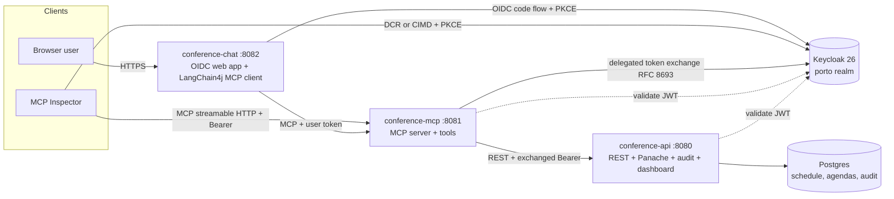
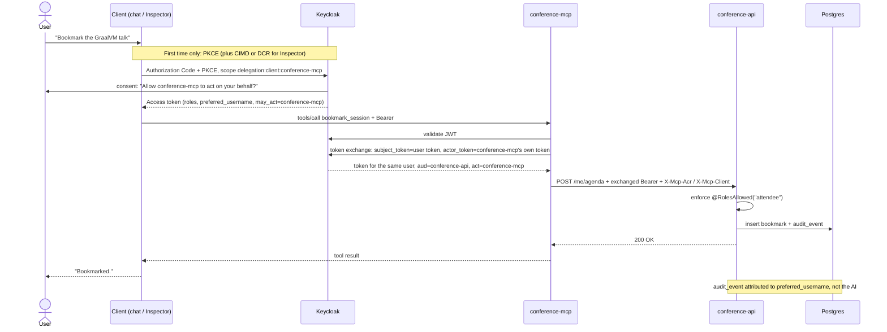

# Practical MCP Security in Action
### Porto Tech Hub 2026 / Conference Companion / Demo backend

> "It wasn't the AI. It was me."
>
> Three demos, three tiers. All against the same Quarkus MCP server and the same audit log.

## Layout

| Path | What it is |
|------|------------|
| `conference-api/`   | Quarkus REST + Panache + Postgres. Owns the schedule, attendee agendas, ratings, and the audit log. Serves the live audit dashboard at `/audit-live`. |
| `conference-mcp/`   | Quarkus MCP server (streamable HTTP). Exposes tools to AI clients and exchanges the user OAuth token (RFC 8693, delegated with an `act` claim when the user consented) for a `conference-api` token on every call. |
| `conference-chat/`  | Quarkus chat client. OIDC web-app login, LangChain4j MCP client to `conference-mcp`, Qute-rendered shell. |
| `keycloak-realm.json` | Single shared realm export at the monorepo root. All three apps reference it via `../keycloak-realm.json`. |
| `DESIGN.md`         | Security decisions, trust boundaries and the deliberate demo shortcuts. |
| `RUNBOOK.md`        | Stage-side runbook with the three-demo flow and the env vars to set. |

No Docker compose file: every backing service is auto-provisioned by **Quarkus Dev Services**.

## Architecture

Three Quarkus apps share one Keycloak realm. Clients authenticate against Keycloak (chat via OIDC code flow + PKCE, MCP Inspector via DCR or CIMD + PKCE), then call the MCP server with a Bearer token. The MCP server validates the token, then exchanges it at Keycloak for a token minted for `conference-api` (RFC 8693 token exchange, delegated so the token names the MCP server as the actor) and calls the API with that. `conference-api` enforces roles and step-up and writes the audit log.



The heart of the demo is identity propagation without token passthrough. The user's token (audience `conference-mcp`) stops at the MCP server. For each API call the MCP server exchanges it for a new token for the same user with audience `conference-api`, `azp=conference-mcp` and an `act` claim naming `conference-mcp`: the user consented at login that this server may act for them. The action is authorized and audited under the user's identity, and the audit log also names the client that acted (`conference-chat via conference-mcp`, `token_act=conference-mcp`).



## MCP protocol version

`conference-mcp` runs on [Quarkus MCP Server](https://docs.quarkiverse.io/quarkus-mcp-server/dev/) 2.0.4 (Quarkus 3.40.1), which implements the latest MCP spec, **2026-07-28**. The headline change in that spec is the **stateless** mode: a client skips the `initialize`/`initialized` handshake, can call `server/discover` to learn the supported versions and capabilities, and sends every request self-contained (`Mcp-Method` and `Mcp-Name` headers plus `_meta` client info). No `Mcp-Session-Id` is issued, so there is no session to go stale after a reload (MCP Inspector and the chat client still run in session mode).

The same `/mcp` endpoint still serves session-based clients on 2025-11-25 and earlier (MCP Inspector, the LangChain4j client in `conference-chat`). Authorization is unchanged across both modes: every request, stateless or not, carries the Bearer token and passes the same gate. `McpProtocolVersionTest` pins this behaviour.

## MCP endpoint authorization

The whole `/mcp` endpoint is gated at the HTTP layer: every request must carry a valid Bearer token whose realm roles include `attendee`. `conference-mcp` runs `quarkus-oidc` in `service` mode (it validates the JWT against the Keycloak JWKS, no client id or secret needed) and adds the `quarkus-mcp-server-oidc` extension, which turns authorization failures into the challenges the MCP authorization spec expects:

- **No token** returns `401` with a `WWW-Authenticate: Bearer ..., resource_metadata="..."` header. The `resource_metadata` URL is the RFC 9728 protected-resource document at `/.well-known/oauth-protected-resource`, and it is what drives an MCP client's discovery and OAuth flow.
- **A valid token without the `attendee` scope** returns `403` with `WWW-Authenticate: Bearer error="insufficient_scope", scope="delegation:client:conference-mcp attendee", resource_metadata="..."`, telling the client exactly which scopes to request: `attendee` for the endpoint, and the delegation scope so the new token still lets `conference-mcp` act for the user (see "Delegation: the token names the agent").

On top of the role check, `conference-mcp` validates the token **audience**: only tokens carrying `aud=conference-mcp` are accepted (`quarkus.oidc.token.audience`), as the MCP authorization spec requires of resource servers. Keycloak has no RFC 8707 resource-indicator support yet, so the audience comes from the realm's `attendee` client scope, which carries audience mappers for `conference-mcp` and `conference-api` (the officially documented Keycloak workaround). `conference-chat` has that scope by default; DCR and CIMD clients request `scope=attendee`, which is exactly what the challenge and the resource metadata advertise. A token from another client in the realm without that scope is rejected with a `401` even if its user has the role, closing the confused-deputy hole of accepting any realm token.

This is the endpoint-level gate. It is distinct from the step-up case in demo 3, where a missing MFA `acr` surfaces per tool as `insufficient_user_authentication`.

## Token exchange and step-up across the hop

The MCP authorization spec forbids token passthrough: an MCP server must not forward the token it received to an upstream API. It does not prescribe how to get the upstream token instead. RFC 8693 token exchange is the approach this demo picks, because it keeps the user's identity end to end.

`conference-mcp` never forwards the user's token. Before every `conference-api` call, `TokenExchangeFilter` exchanges it at Keycloak (RFC 8693). Keycloak allows it only because `conference-mcp` is a confidential client with standard token exchange enabled and the `conference-api` audience in its default client scopes. Any other requested audience is refused. `conference-api` validates `aud=conference-api` in every profile, so a user token sent straight to the API is rejected with a 401.

### Delegation: the token names the agent

The exchange is a **delegated** one (Keycloak 26.8 token exchange delegation, a preview feature):

1. The client asks for the parameterized scope `delegation:client:conference-mcp` at login. Keycloak shows "Allow conference-mcp to act on your behalf?" on the consent screen, on every login and step-up (the delegation consent is never stored).
2. Keycloak checks that `conference-mcp` holds the `delegate` permission for the user (Fine-Grained Admin Permissions v2, `conference-mcp may act for any user` in the realm) and puts `may_act: {client_id: conference-mcp}` in the user's token.
3. `conference-mcp` sends the user's token as the `subject_token` and its own service-account token as the `actor_token`. Keycloak returns a token for the same user with `act: {client_id: conference-mcp}`.
4. `conference-api` records the `act` client as `token_act` in the audit log, and trusts the hop headers only when the acting client (`act`, else `azp`) is `conference-mcp`.

Quarkus' token propagation filter cannot send an `actor_token` yet, so the exchange lives in `DelegatedTokenExchange` instead of `quarkus.rest-client-oidc-token-propagation.exchange-token`. A token without `may_act` (the Dev UI, or a client that did not ask for delegation) gets the standard exchange: same user, same audience, no `act`. Keycloak refuses to mix them up: a standard exchange of a token with `may_act` fails, and so does a delegated exchange without it. The `conference-mcp` terminal logs which one ran.

### What the exchange still drops

Neither exchange keeps the **step-up level**: an `acr` of `urn:porto:mfa` comes back as `1` (verified against Keycloak 26.7.4 and 26.8.2; `scope`, `acr_values` and `claims` on the exchange request do not change it). And neither says which client the user signed in with: `azp` and `act.client_id` are both `conference-mcp`. So the hop that saw the original token enforces and asserts both:

- `conference-mcp` checks the `acr` on the user's token before any step-up tool runs.
- It sends what it verified as `X-Mcp-Acr` and the client the user signed in with as `X-Mcp-Client`.
- `conference-api` trusts those headers **only** when the token's acting client is `conference-mcp`. Only that client holds the secret to obtain such a token. For any other caller, the token's own `acr` is all that counts.

The fix for both belongs in the authorization server: carry the subject's `acr` across the exchange, and record the chain of clients (RFC 8693 allows nested `act` claims). Until then the headers stay.

## Client registration: DCR vs CIMD

An AI client has to obtain an OAuth client identity before it can run PKCE. The demo shows both mechanisms against the same realm: CIMD, the recommended path, and DCR, which the 2026-07-28 spec deprecates and keeps only for backwards compatibility with authorization servers that do not support CIMD yet. Keycloak is one of them: its CIMD support is still an experimental feature.

**Dynamic Client Registration (DCR)** has the client POST to a writeable registration endpoint and get back a generated `client_id`. To make this work for MCP Inspector, the realm clears three anonymous registration policies and keeps the consent prompt (documented in [`RUNBOOK.md`](RUNBOOK.md)). The talking point: "the AI got a token" is not "the AI got a useful token", every scope, role, and claim has to be consciously engineered back in. Delegation adds one more catch: Keycloak's DCR matches scope names literally, so a client that registers with `delegation:client:conference-mcp` (what the resource metadata advertises) gets no delegation scope and its login fails with `invalid_scope`. It has to register with `delegation:client`.

**Client ID Metadata Documents (CIMD)**, recommended since the MCP 2025-11-25 spec (SEP-991), drop the registration step entirely. The `client_id` is an HTTPS URL, and Keycloak fetches the client metadata document at that URL. The demo serves one at `conference-mcp/.../META-INF/resources/cimd/mcp-inspector.json`, enabled through Keycloak's experimental `cimd` feature (`quarkus.keycloak.devservices.features=cimd,...`). The document lists `delegation:client` among its scopes, so the client record Keycloak builds from it may ask for the delegation scope.

| | DCR | CIMD |
|--|-----|------|
| Client identity | Generated `client_id` from a registration call | An HTTPS URL that is the `client_id` |
| Server state | A stored registration record per client | None, the document is fetched on demand |
| Registration endpoint | Writeable, must be opened and policed | None |
| Realm setup for this demo | Three anonymous policies cleared, consent kept | An experimental feature flag, a client policy and profile that say which URLs to trust, and a role scope mapping on the `attendee` scope |
| Spec status | Deprecated in 2026-07-28, kept for authorization servers without CIMD | Recommended since 2025-11-25 |

## Run

```bash
# Terminal 1 - conference-api on :8080
cd conference-api && ./mvnw quarkus:dev

# Terminal 2 - conference-mcp on :8081
cd conference-mcp && ./mvnw quarkus:dev

# Terminal 3 - conference-chat on :8082 (needs an Anthropic API key for the LLM)
export ANTHROPIC_API_KEY=...
cd conference-chat && ./mvnw quarkus:dev
```

Without a key, or without network, the chat falls back to a scripted planner that only understands the demo prompts in its sidebar; set `DEMO_PLANNER=scripted` to skip the model entirely. The MCP calls, tokens and audit trail are the same either way.

On first start Dev Services boots:

- a **Postgres 18** container for `conference-api` (schema owned by Hibernate via `drop-and-create`, auto-seeded with the schedule and demo data)
- a **Keycloak 26.8.2** container (pinned in `application.properties`) with the `porto` realm pre-imported, shared between all three apps via `service-name=porto-keycloak`

The realm export lives once at the monorepo root (`./keycloak-realm.json`). All three apps reference it via `quarkus.keycloak.devservices.realm-path=../keycloak-realm.json`.

Dev UI for each app lives at `http://localhost:8080/q/dev/`, `http://localhost:8081/q/dev/`, and `http://localhost:8082/q/dev/`.

Playwright end-to-end tests live inside `conference-chat`: run them with `cd conference-chat && ./mvnw test`.

## Demo dashboard

`http://localhost:8080/audit-live/` shows the second-screen view used in demos 2 and 3. The styling matches the talk deck: dark surface, brand blue for normal events, amber for step-up tools, red for destructive actions, mono font for `audit_event` rows.

Open the page on a secondary monitor and run the demos. New events appear within two seconds of every tool call.

## Demos

See [`RUNBOOK.md`](RUNBOOK.md) for the moment-by-moment script of the three live demos:

1. **Public** browse the schedule. PKCE + Authorization Code Flow, and MCP Inspector getting its client identity through CIMD, live. DCR is covered on slides.
2. **Personal** agenda, ratings, conflicts. Token exchange per hop, full audit.
3. **Sensitive** speaker-only tools with step-up MFA. Server-driven challenge, and an indirect prompt injection in attendee feedback that step-up and the API's ownership check contain.

## What's next

Two follow-ups the demo deliberately leaves out:

1. **Drop the hop headers.** The delegated token names the agent, but the `X-Mcp-Acr` / `X-Mcp-Client` headers stay until Keycloak carries the step-up `acr` across the exchange and records the originating client (see "What the exchange still drops").
2. **Enterprise-managed authorization.** An optional MCP extension where the company's identity provider decides which MCP servers employees may use. The IdP issues an identity assertion grant (ID-JAG) via token exchange, and the MCP server's authorization server trades it for an access token: no consent screen per MCP server, central control for IT. It is the same token exchange building block this demo uses downstream, applied at the front door. Showing it would need a separate enterprise IdP in front of the MCP server's authorization server, which is out of scope for this talk.

## Brand palette (lifted from the deck)

| Role | Hex | Where it shows up |
|------|-----|-------------------|
| Background    | `#0E1116` | Audit dashboard surface |
| Surface       | `#171B22` | Cards, top bar |
| Border        | `#2A313C` | Card outlines |
| Primary text  | `#F5F7FA` | Headings, key values |
| Muted text    | `#9AA4B2` | Subtitles, field labels |
| Brand         | `#0088D3` | Normal actions, links, accents |
| Amber         | `#F2A65A` | Step-up / sensitive actions, identity highlights |
| Body type     | Calibri / system sans | Headings, prose |
| Mono type     | Consolas / JetBrains Mono | `audit_event`, identifiers |

## Conventions

- No em dashes anywhere in code, comments, or docs (Lunatech house style).
- Tests run against Quarkus Dev Services (Testcontainers under the hood); no manual infra needed for `mvn test`.
- Hibernate owns the schema (`drop-and-create` in dev/test). No Flyway.
